# oh-my-agent-web

[中文](README.md) · **English**

One line: **an external control surface for the agent you're already running.** The engine keeps running on your own machine; the web page is where you watch it work, manage its tools and models, cut in to correct it whenever you like, and — when the moment comes — read files, open a terminal, or highlight a passage and ask for a change.

Single user, loopback only, and **the engine's own on-disk files are always the source of truth for a conversation** — no database, no account system, no second copy of the session in our own store. One `oh-my-agent-web` process is one person's workbench.

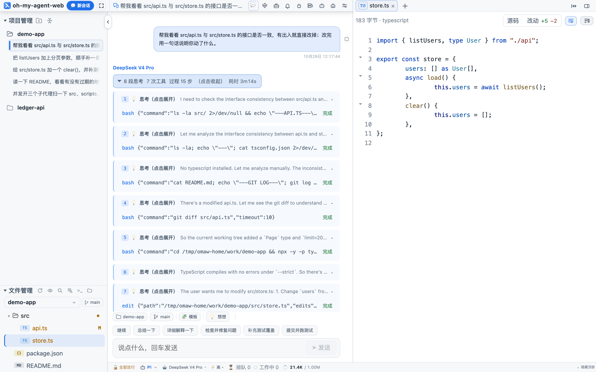

> Every screenshot below is the real UI of this repo (the 0.8.0 build) — pi engine + DeepSeek, working on a small `demo-app` project.
> Directories, commands, the `+6 −1` diff, tokens and cost all come from that actual run — no collages, no mockups.
> What each shot shows, how it was taken and how it was compressed is in [`docs/screenshots/README.md`](docs/screenshots/README.md).

---

## Install

Requires **Node.js ≥ 22.19** and **npm ≥ 9**; macOS / Linux / Windows all work. You end up with an `oh-my-agent-web` command (short aliases: `aw`, `agent-web` — all equivalent).

### Install globally with npm (recommended)

```bash
npm -g install oh-my-agent-web
```

No version tag means the current release. To pin a version or use a mirror:

```bash
npm -g install oh-my-agent-web@latest
npm -g install oh-my-agent-web@<version> --registry=https://registry.npmmirror.com
```

You get three commands that all point at the same entry point: **`oh-my-agent-web`** (used throughout this README),
`aw` (the short alias you'll probably type), and `agent-web`.

Upgrade and uninstall:

```bash
oh-my-agent-web upgrade               # same as npm -g install oh-my-agent-web@latest
npm -g uninstall oh-my-agent-web      # uninstall; data in ~/.oh-my-agent-web is left alone
```

On Linux, `node-pty` (the embedded terminal) ships prebuilds only for macOS / Windows, so Linux compiles it in place: you need `make`, `g++` and `python3`. When those are missing, both the page and the install script say exactly what's missing — the terminal won't open until then.

### One-line install (never touches global npm)

macOS / Linux:

```bash
curl -fsSL https://raw.githubusercontent.com/duzhenxun/oh-my-agent-web/main/scripts/install.sh | sh
```

Windows (PowerShell):

```powershell
powershell -c "irm https://raw.githubusercontent.com/duzhenxun/oh-my-agent-web/main/scripts/install.ps1 | iex"
```

The script does four things: **finds a new enough Node** (downloads an official build into `~/.oh-my-agent-web/node` and checks its sha256 if needed), **`npm install -g --prefix ~/.oh-my-agent-web`** (never the system-wide prefix, no sudo), **links `aw` / `agent-web` / `oh-my-agent-web` into `~/.local/bin`** (patching PATH if necessary), and **smoke-tests once** (version string + whether `node-pty` can be required, i.e. whether the terminal will open).

That `~/.oh-my-agent-web` is also the **data directory**: what gets installed (`node/`, `lib/`, `bin/`) sits next to your `settings.json`, `password`, `uploads/` and `logs/`.

| What you want to change | How (`sh` version; PowerShell uses env vars) |
|---|---|
| Version | `OH_MY_AGENT_WEB_VERSION=<version>` (or `--version <version>`) |
| Install elsewhere | `OH_MY_AGENT_WEB_HOME=/opt/oh-my-agent-web` (or `--home /opt/oh-my-agent-web`) |
| Registry mirror | `OH_MY_AGENT_WEB_REGISTRY=https://registry.npmmirror.com` (or `--registry …`) |
| Leave PATH alone | `OH_MY_AGENT_WEB_NO_PATH=1` (or `--no-modify-path`) |
| Install build tools | `OH_MY_AGENT_WEB_BUILD_TOOLS=1` (or `--with-build-tools`) |
| Uninstall | `… \| sh -s -- --uninstall` (removes only what was installed; `settings.json` / password / uploads / logs stay) |

---

## Commands

The three commands are completely equivalent; everything below is written as `oh-my-agent-web` (`aw` is its short alias).

| Command | What it does |
|---|---|
| `oh-my-agent-web` | **Start (default)**: runs in the background and opens the browser, handing the terminal straight back; default workspace = current directory |
| `oh-my-agent-web start -f` | Run in the foreground, logs right in the terminal, `Ctrl-C` to quit |
| `oh-my-agent-web status` | pid / port / uptime / engine / session count / workspace |
| `oh-my-agent-web restart` | Stop then start (background by default; `-f` for foreground) |
| `oh-my-agent-web stop` | Stop the running instance (foreground or background — it reads the lock file in the data dir instead of guessing a port) |
| `oh-my-agent-web version` | Version string (`-v` / `--version` are synonyms) |
| `oh-my-agent-web upgrade` | Upgrade to the latest release (it runs `npm -g install oh-my-agent-web@latest`) |
| `oh-my-agent-web help` | Show help (`-h` / `--help` are synonyms) |

### Flags

| Flag | Env var | Default | Notes |
|---|---|---|---|
| `-p, --port` | `AGENT_WEB_PORT` | `25257` | Listen port |
| `-H, --host` | `AGENT_WEB_HOST` | `127.0.0.1` | Listen address; only change it for remote access |
| `-P, --password` | `AGENT_WEB_PASSWORD` | none | Login password; unset = loopback only (a remote first visit asks you to set one) |
| `-f, --foreground` | — | off (background by default) | Foreground run, logs in the terminal; `-d` / `--detach` is the old spelling and now equals the default |
| `--no-open` | — | on | Don't open the browser |
| `--allow-host` | `AGENT_WEB_ALLOWED_HOSTS` | loopback only | Extra allowed hostnames / LAN IPs (repeatable or comma-separated) |
| `--data-dir` | `AGENT_WEB_DATA_DIR` | `~/.oh-my-agent-web` | Settings, password, uploads, logs and the lock file live here |
| — | `AGENT_WEB_CWD` | `process.cwd()` | Default workspace (before any session exists) |
| — | `AGENT_WEB_ENGINE` | `pi` | Default engine |
| — | `AGENT_WEB_APPROVAL_MODE` | `allow` | Default approval mode for new sessions; `ask` confirms every tool call |
| — | `AGENT_WEB_TURN_TIMEOUT_MS` | 20 minutes | Per-turn watchdog timeout |
| — | `AGENT_WEB_LOG` | `info` | `debug` / `info` / `warn` / `error` |

### Common examples

```bash
oh-my-agent-web                                    # background + open the page (the usual one)
oh-my-agent-web -f                                 # foreground, logs in your face, Ctrl-C to quit
oh-my-agent-web -p 25258                           # different port (when 25257 is taken)
oh-my-agent-web status && oh-my-agent-web restart  # check, then restart
oh-my-agent-web stop                               # stop it (works for foreground and background)
oh-my-agent-web --data-dir ~/agent-web-data             # different data directory
AGENT_WEB_CWD=~/code/my-proj oh-my-agent-web       # set the default workspace
oh-my-agent-web -H 0.0.0.0 --allow-host agent.example.com   # allow outside access (first visit asks you to set a password)
```

> **Reaching it from your phone**: `oh-my-agent-web -H 0.0.0.0 --allow-host your.domain`. The first visit from the phone asks you to **set an access password** (stored as `password` in the data dir; after that you just log in). Reverse proxies / tunnels should pass `X-Forwarded-For` (origin checking looks at it).
>
> **Running `oh-my-agent-web` from your home directory** works, but home is an unsafe workspace (the file tree, search and the agent's cwd would be your whole home). In that case it falls back to `<data dir>/workspace` and prints a line about it; to point at a project use `AGENT_WEB_CWD=/path/to/project`.

Each engine also has its own escape hatches (all have defaults; you normally don't touch them): `AGENT_WEB_CODEX_BIN` / `_HOME`, `AGENT_WEB_DSH_BIN` / `_HOME` / `_MODEL` / `_PATCH`, `AGENT_WEB_OPENCODE_BIN` / `_ARGS` / `_MODEL`, `AGENT_WEB_CLAUDE_BIN` / `_ARGS` / `_MODEL` (it auto-detects `claude-code-acp` / `claude-agent-acp` and says so when neither is installed).

---

## What it is, what it isn't

**It is**: a front end that spreads the agent's *process* out in front of you. Thinking blocks, tool calls, changed files, tokens and cost all live in the conversation stream. You can cut in mid-turn, highlight a passage to file a comment on it, or open a scratch chat that never touches disk just to ask one question.

**It is not**: a new agent engine, and it is not a SaaS that moves your sessions into the cloud. It does not rewrite prompts and does not take over tool implementations — what you install is pi / Codex / Claude Code / opencode / DeepSeek Harness, and the workbench just gives them a readable UI, clickable buttons, and a session list that survives restarts.

Three hard rules:

1. **No database**: a conversation *is* the JSONL / thread the engine wrote. The web UI reads it, renames it, and deletes it when asked.
2. **No pretending**: anything an engine can't do is hidden in the UI (the capability matrix); a panel that can't get data says so, and no other engine's config is passed off as this one's.
3. **No overreach**: it listens on `127.0.0.1` only by default; exposing it remotely takes all three of `-H`, `-P` and `--allow-host`.

---

## Conversation

**Streaming text + collapsible thinking blocks + tool cards.** A tool card shows arguments, the full command (copyable), output, duration and pass/fail. Thinking and tool calls inside one turn are grouped into "process, N steps" blocks that expand when clicked.

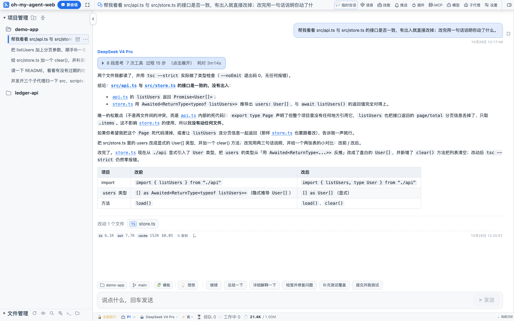

The footer of every reply is the usage **for that turn**: input (cache miss) / output / cache read / cost, with a "Copy" that takes the whole block. The running total for the session is behind the context ring in the status bar (subagents are separate sessions billed separately and are not counted there).

A few things in the conversation are clickable:

- **Changed-files chip**: which files this reply touched (the chip at the bottom of the screenshot above shows `store.ts`); one click lands you straight on the diff in the right pane.
- **Branch icon**: "Branch from here", which starts a new conversation at this message; the original stays byte-for-byte unchanged.
- **File paths**: a path like `web/src/App.tsx` in the body opens in the preview.

### Cutting in, queueing, stopping

While a turn is running, the composer does not lock up:

| Action | Meaning |
|---|---|
| **Steer** | Takes effect immediately, inserted into the current turn as the next instruction |
| **Queue** | Wait until this turn ends; you can see what's at the head of the queue and retract anything |
| **Stop** | Interrupt the turn and keep whatever was already produced |

Steering is pi-only (its SDK has `streamingBehavior: "steer"`). Other engines have no such notion, so the host **degrades it to queueing** rather than firing a second message that would flush the active turn.

---

## Notes: highlight a passage and comment on it

**Select some text in the conversation** and a small toolbar floats up: `Add to session` / `Annotate` / `Ask in a temp session`.

<table><tr>
<td width="50%">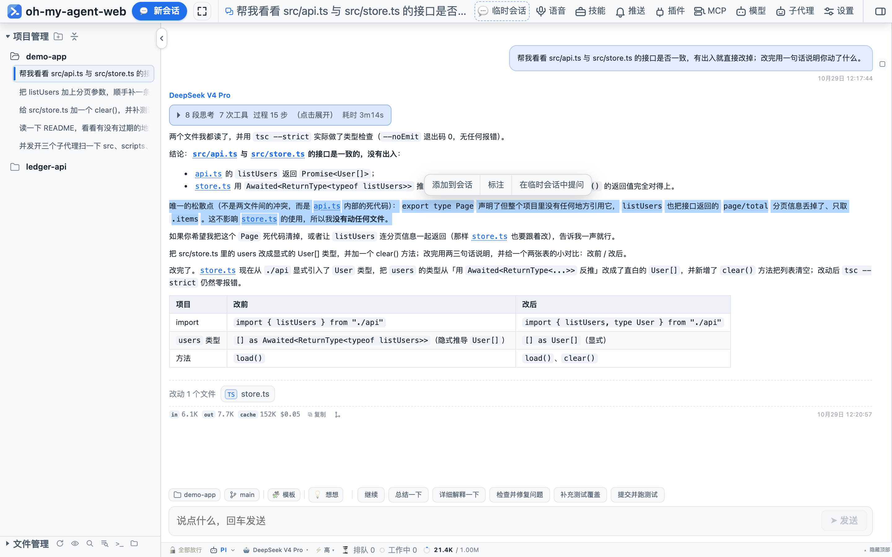</td>
<td width="50%">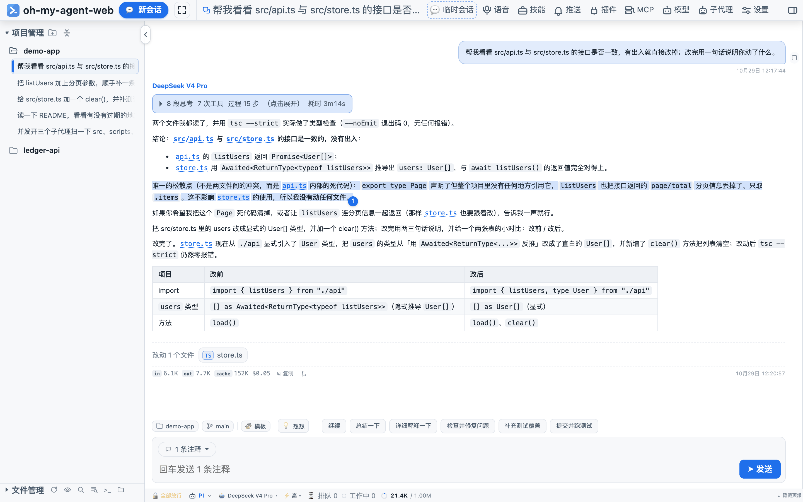</td>
</tr></table>

"Annotate" attaches a comment to that text. The body keeps a **①②③ numbered badge**, and an "N notes" pill appears in the composer — open it to read, edit or delete each comment, or `Quote it`.

On send it is assembled into a block like this (you can also hit `Quote it` yourself, in which case only your own words go out):

```
Note 1:
> The panel starts at y=0, but the top bar's z-index is 45

This needs to be one sentence shorter
```

Notes are **local anchors**: they locate themselves by "quoted text + surrounding context", so badges still find their place after the body reflows or a stream appends more text. They live in this browser's `localStorage`, isolated per session — never on the server, never in the cloud, invisible from another device.

**Line references in files** are the other road: select lines in the preview (`Shift+click` for a range, `Ctrl/Cmd+click` to add, right-click for the line menu) and "Add to conversation" writes a **path plus line numbers** such as `@web/src/App.tsx:120-138`, leaving the agent to read it.

---

## Side chat: ask one question and go

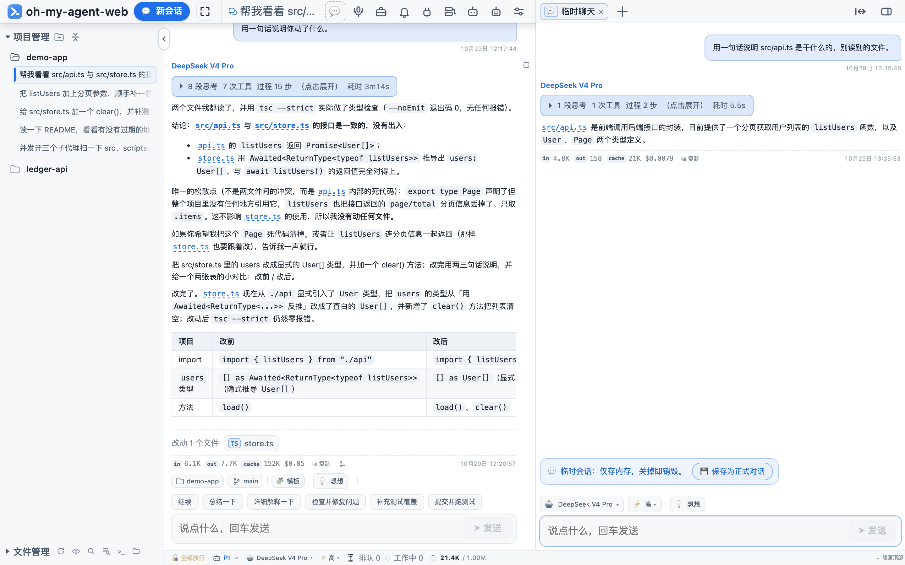

The `Temp session` button in the top bar (or the first card on the right pane's landing page) opens another conversation **in the right pane**:

- **Not persisted**: it lives in memory, dies with the tab, never enters the sidebar and leaves no file;
- the main conversation keeps running; the two don't interrupt each other;
- to keep it, hit `Save as a regular chat` — only then is a session file written (history the ephemeral chat never had is preserved too);
- you can have several open at once, each on its own channel and its own tab.

> This depends on the engine having an in-memory session: pi supports it; a Codex thread already lives in Codex's own store, so there is no "save" button. It is not "a new session in a different skin", and it is not a subagent — **an ephemeral chat is a window you opened, a subagent is a subtask the agent dispatched**.

---

## Files, diffs, git, search

The files area sits at the bottom of the sidebar and also works as a tab in the right pane. **The web side is read-only**: you can look, compare, reference and search; editing files in place and saving them is not this layer's job — give that to the agent's tools or the terminal, and use the diff here to review it.

| Capability | Notes |
|---|---|
| Directory tree | Switchable root (follow the session / pick a project), lazy loaded, at most 500 entries per directory, `node_modules` / `.git` / `dist` hidden by default, "show hidden files" reveals `.env` and friends |
| Search by file name | Matches names only, never reads contents, 250 ms debounce, at most 200 hits |
| Preview | markdown (tables / code highlighting / mermaid), source with line numbers, images, PDF, audio and video streams; multiple tabs, drag to reorder, right-click to close left / right / all, and it can be spread over the full width |
| Line references | Select lines → "Add to conversation" writes `@path:line`; a text selection can also be "copy selected text" |
| Reveal in Finder | macOS `open -R`, Windows `explorer.exe /select,`, Linux opens the parent directory |
| Uncommitted changes | Status dots in the file tree, plus `M` / `U` / `D` after the filename |

### Diff


The "diff" toggle at the top of the preview is a comparison against `HEAD`: a `+285 −78` summary, line-level red/green, and a switch between "changes only" and the full file. Coming in from a changed-files chip lands directly on the diff.

### git

The branch chip at the top of the files area lists local branches and switches them (a dirty working tree asks first). It only shells out to `git` for reads and branch switches — it never commits. Committing stays with the agent, or with you in a terminal.

### Content search

"Search file contents" in the toolbar is a full-text search: add a **path mask** (such as `web/src/**`) to narrow it, results show `file:line` plus a snippet of the source, and clicking one jumps to that line. When there are too many hits it truncates at the cap and says so.

---

## Terminal

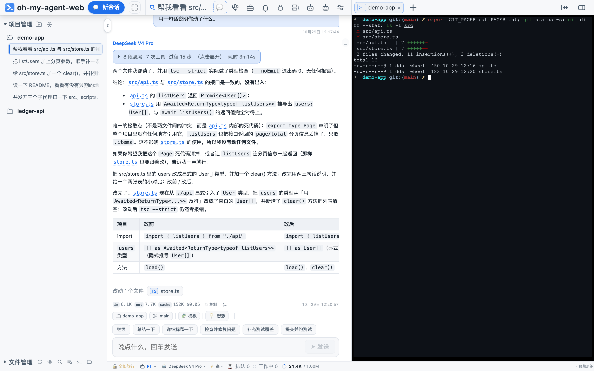

The terminal in the right pane is a **real PTY** (`node-pty` + xterm.js): vim / top / Ctrl-C / colors / line editing all behave, the cwd matches the session's project, and you can pass one initial command (the upgrade flow uses exactly that).

Reloading the page does not restore a terminal session (the PTY exits with the page); switching tabs does not break it. On Linux `node-pty` has to be compiled in place, and when the tools are missing the UI says exactly what to install.

### Built-in web page

The right pane also opens web pages: type a URL and view it in an iframe, with requests going through **a local proxy** (`/web/p/<url>`) — it fetches the document and strips the `X-Frame-Options` / CSP framing restrictions, so sites like Baidu open too. The proxy has boundaries: HTML/CSS documents only, **no cookies in and none out**, a 12 MB upstream cap, and an iframe sandbox without `allow-same-origin`. For sites that need a login or heavy JS, hit `⧉` to jump to the system browser.

---

## Engines: each runs its own native loop

The engines are not "the same prompt in different costumes" — each is that vendor's own agent loop:

| Engine | How it's wired | Notes |
|---|---|---|
| **pi** (default) | Native SDK | The full plugin / skill ecosystem, lazy tool loading, the approval gate, subagents, steering; models and providers are managed by this workbench |
| **Codex** | app-server (JSON-RPC) | Its own loop and sandbox; sessions are shared with Codex Desktop / CLI; approvals are command- and file-level |
| **DeepSeek Harness** | ACP | Model and thinking level are switchable; permissions confirmed one by one |
| **opencode** | ACP | Its own tools / MCP / plugin ecosystem; sessions are shared with the opencode CLI / TUI; approvals follow opencode's own `permission` config |
| **Claude Code** | ACP (the `claude-code-acp` adapter) | Switchable models, per-call tool confirmation; sessions are shared with the `claude` CLI; this ACP surface exposes neither thinking levels nor subagents |
| **fake** | Built-in scripted engine | Zero tokens, only for exercising the protocol / tools / approval flow (not in the picker by default) |

The differences (the capability matrix in `server/engine/registry.ts`, which the UI uses to hide buttons):

| Capability | pi | codex | dsh | opencode | claude |
|---|:-:|:-:|:-:|:-:|:-:|
| Approvals | ✅ | ✅ | ✅ | per config | ✅ |
| Model / thinking level | ✅ | ✅ | ✅ | ✅ | model only / no levels |
| Resume past sessions | ✅ | ✅ | ✅ | ✅ | ✅ |
| Steering | ✅ | — | — | — | — |
| Subagent panel | ✅ | — | — | — | — |
| Workbench-managed providers | ✅ | — | — | — | — |
| Side chat (in memory) | ✅ | — | — | — | — |

**The models / plugins / MCP panels follow the active engine**: switch to Codex and the panels read Codex's own data (`model/list`, `plugin/list`, `config/read`); claude reads `~/.claude.json` and `~/.claude/settings.json`; opencode reads `opencode.json`. A panel that has nothing wired says so instead of borrowing pi's config.

Engines are switched in the **bottom status bar** (not the top bar), and every session remembers its own engine, model and thinking level.

---

## Models and providers

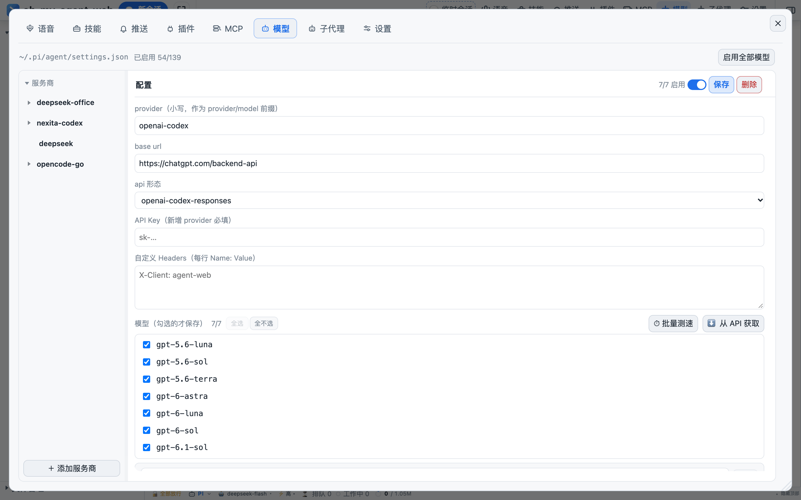

- **Subscriptions**: OAuth login (9 providers), usable right after signing in — no key to copy by hand.
- **Official built-ins**: the ones pi's catalog carries models for — **paste one key and it works**; endpoints and model tables come from the catalog.
- **Bring your own**: change the API shape (openai-completions / responses / anthropic-messages / codex / typesafe), the base URL and custom headers, and add models one by one.
- Tick models individually (only ticked ones are saved), batch-test connectivity, pull the list from `/models`, and save the ticked set as the allowlist.

**Keys never leave the server**: the API returns only `hasKey` and the last 4 digits; writes are serialized inside the process so concurrent edits can't corrupt a file.

The truth is spread across `~/.pi/agent/models.json` (the provider catalog), `models-store.json` (the legacy location) and `auth.json` (`api_key` or OAuth credentials), with the allowlist in `settings.json.enabledModels`.

---

## Skills

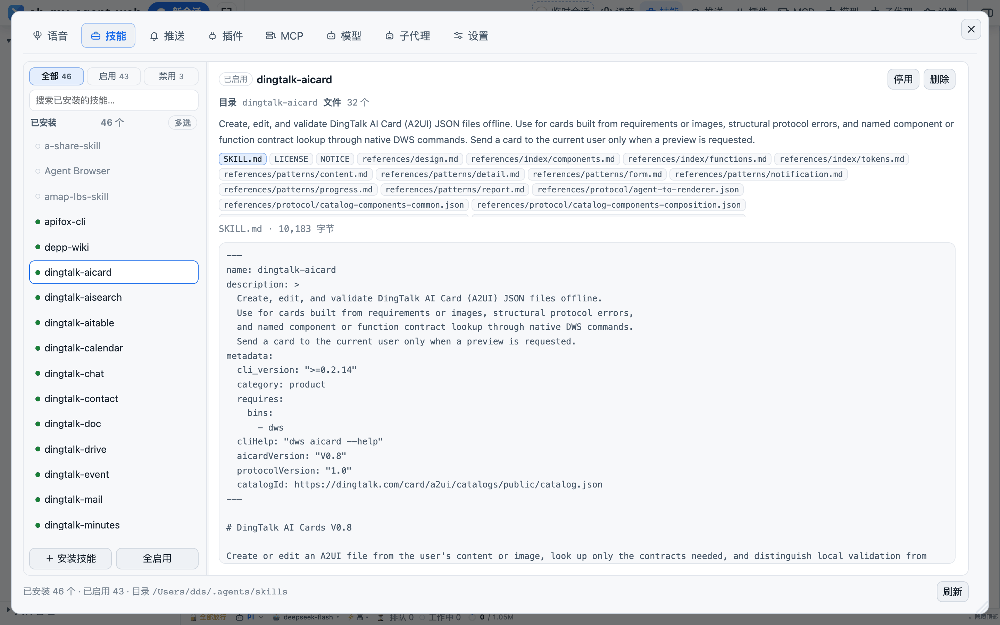

Reads `~/.agents/skills/<dir>/SKILL.md`; the list parses frontmatter only (no yaml dependency). **Enabling or disabling means renaming `SKILL.md` to `.SKILL.md.disabled`** — there is no second state file, so what you see in the CLI agrees with what you see here.

**Skill Hub**: search by category plus one-click install (200k+ index); it can also install a specific `skills/<name>` from a Git repo, or create one by hand.

---

## MCP

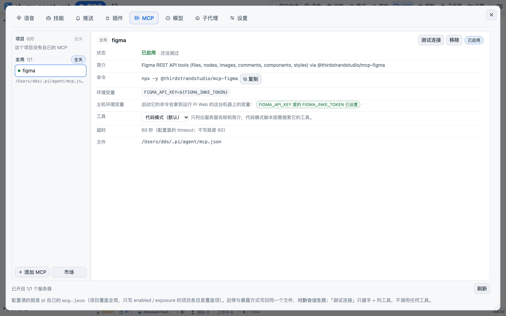

Reads and writes two config files: `~/.pi/agent/mcp.json` (global) and `<workspace>/.pi/mcp.json` (project), where **a project entry with the same name overrides the global one**, and writes preserve indentation and CRLF.

- exposure has four levels: **codemode (default) / deferred / direct / hidden**;
- **Test connection**: a real handshake plus `tools/list`, then disconnect; it reports the connection state and the tool count;
- OAuth login, pick a server from a marketplace, paste a command / URL / JSON and let it be parsed;
- **the config is the truth**: pi connects at session start, so edits apply to **new sessions**.

---

## Plugins

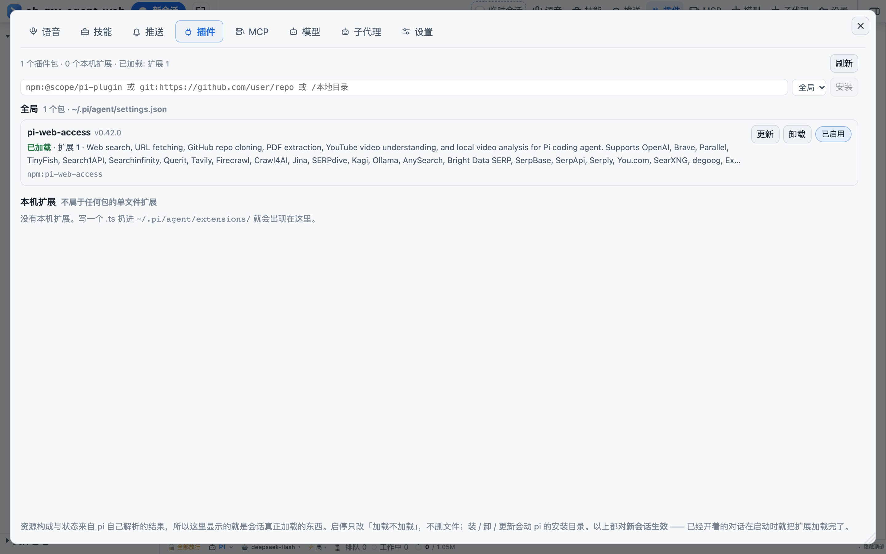

Plugins are pi packages: the `packages` entry in `settings.json` (npm / git / local directory) plus the loose `~/.pi/agent/extensions/` and `<ws>/.pi/extensions/`.

State comes from the pi SDK's `resolve()` (**querying never triggers `npm install`**), with four states `loaded / installed / missing / disabled`; disabling per package writes `autoload:false` and deletes nothing.

---

## Subagents: run many, manage each

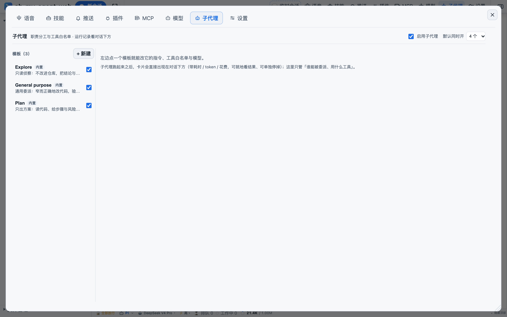

Once the main agent has the `Agent` tool it can run several subagents in parallel, and each one is **a real session** (its own context, session file and tool allowlist).

- **Watch**: the subagent card strip above the composer — status, duration, tool count, tokens, cost. "View result" expands the raw result and the session file path in place, and any single run can be stopped. The heading gives the at-a-glance count (`2 running` / `8 finished`).
- **Manage**: the top-bar "subagents" panel manages **templates** (built in: explore / general-purpose / plan, each disableable; you can also create, edit and delete your own): `name / display_name / description / tools / model / thinking / max_turns`. They land in `~/.pi/agent/agents/*.md`, in the same format as pi's agent files — readable, editable, git-friendly.
- **Concurrency**: 1–12 (default 4); anything beyond that queues. Turn the master switch off and the model no longer sees the `Agent` tool.
- **Isolation**: subagents load no skills / plugins / themes / context files by default (fast and predictable); a subagent that doesn't pin a model keeps using the parent session's model.

A subagent's session file is archived next to the parent session (`<parent session dir>/<parent name>/subagents/`) and never shows up in the sidebar's project list.

---

## Push and voice

<table><tr>
<td width="50%">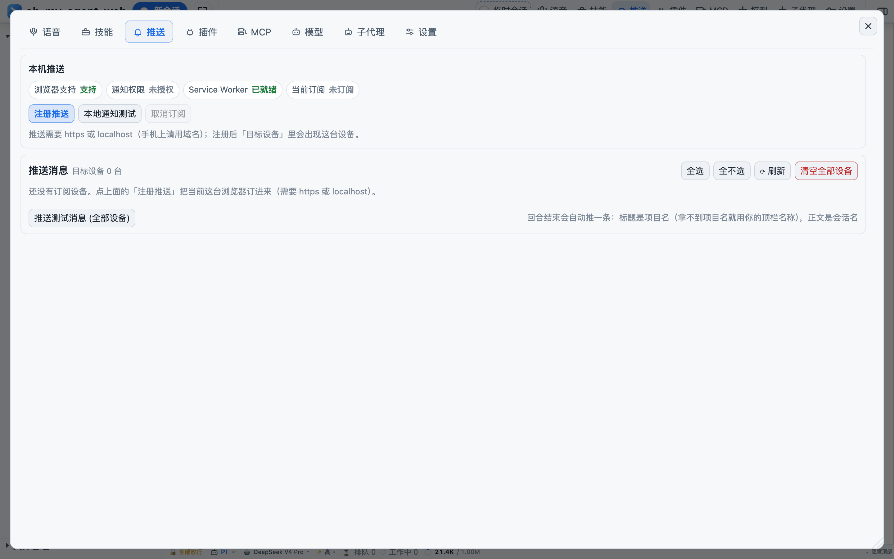</td>
<td width="50%">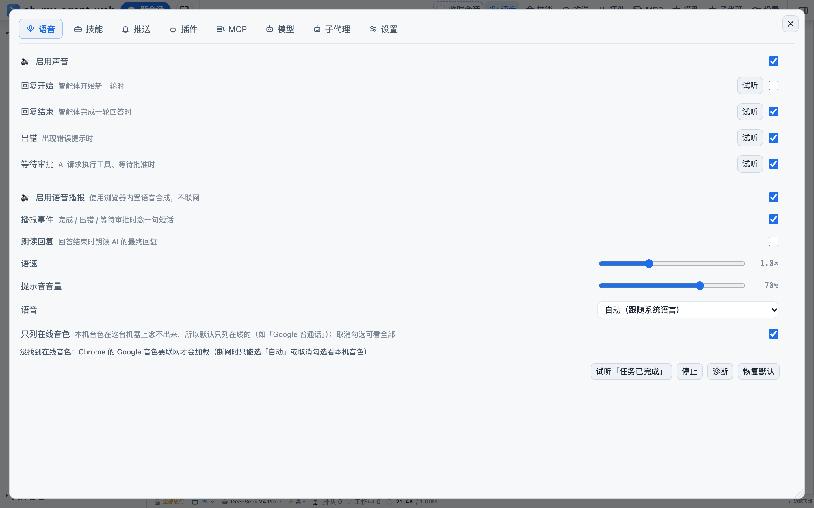</td>
</tr></table>

**Push**: Web Push (VAPID) subscriptions, one notification per finished turn — title is the project, body is the session, with a ❌ / ⏹ prefix for failures and interrupts. Multiple devices, a test push, and a one-click clear-all. Needs https or localhost.

**Voice**: four event sounds (start / finish / error / waiting for approval) with preview and adjustable volume; local TTS reads the final reply using the browser's built-in voices, with adjustable rate and voice, and never touches the network.

---

## Settings

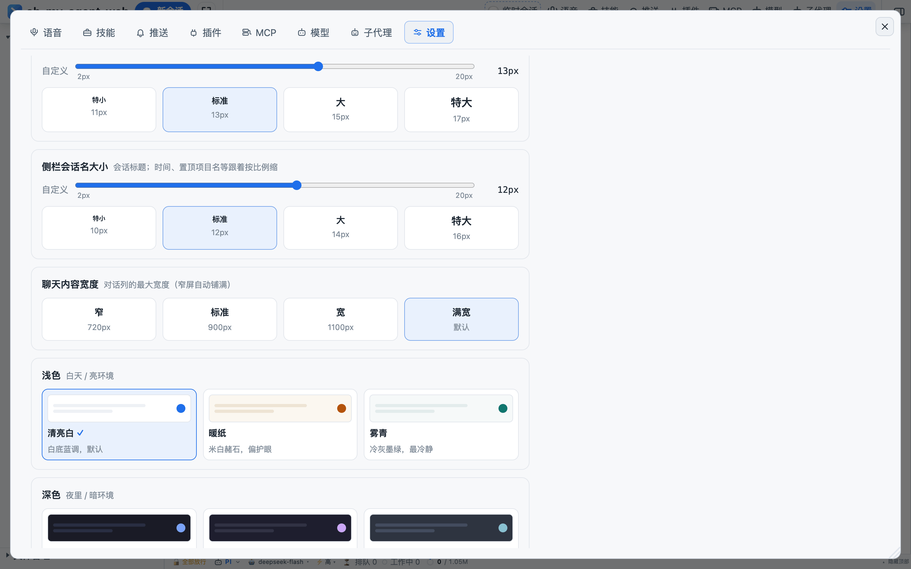

The top bar is the entry point for every panel, and **each entry can be hidden in Settings → Interface** (settings and the split toggle are exempt — they're the only way back to the others). The sidebar and the right pane both drag wider and collapse, and their widths are remembered locally in `localStorage`.

The "settings" button opens five pages:

| Page | Contents |
|---|---|
| **Interface** | Which top-bar entries show (text and icon ticked separately), which status-bar chunks show (queue / working / context usage), whether cost shows in the conversation, which blocks sit above the composer (templates / thinking / quick commands), and whether thinking blocks and tool cards start expanded |
| **General** | The text of your quick phrases and the default thinking level — saved server-side, identical on every device |
| **Appearance** | Three font sizes (chat body / sidebar project names / sidebar session names, slider 2–20px), content width in 4 steps (720 / 900 / 1100 / full), 6 palettes (bright white, warm paper, mist teal, Tokyo night, mocha, nord), and the top-bar name and logo (hideable, or replaced with your own) |
| **Language** | Chinese / English, applied immediately |
| **Shortcuts** | 11 actions, rebindable, clearable and restorable to defaults, plus a cheat sheet |

Appearance, interface and language preferences stay on the device only (`localStorage`, with the `agent-web.` prefix) — one copy per phone, tablet and desktop. Only the quick phrases in "General" are shared across devices.

---

## Mobile

<table><tr>
<td width="34%">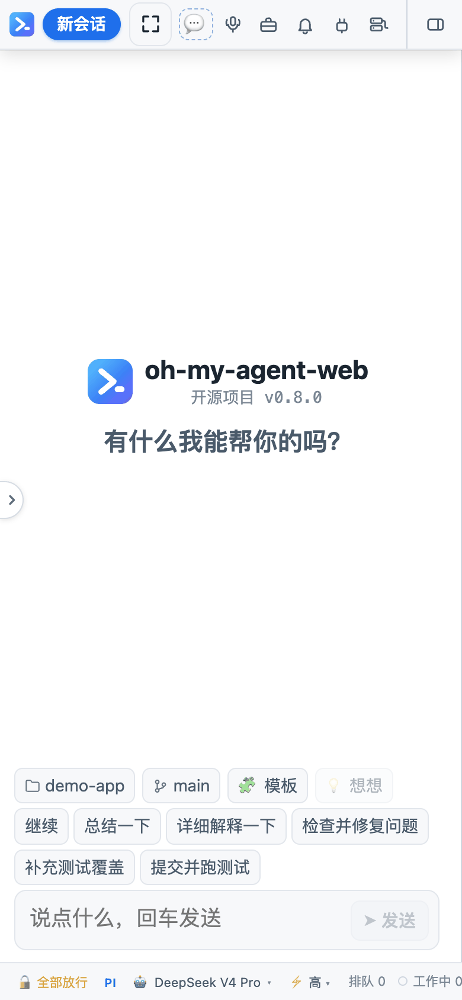</td>
<td width="34%">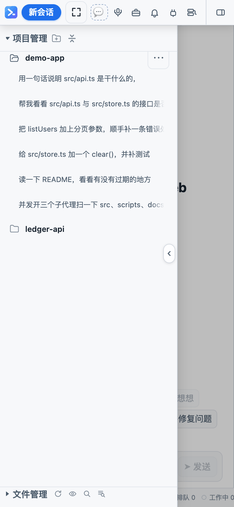</td>
</tr></table>

On narrow screens (mobile UA or ≤400px) the layout collapses to a single column:

- the sidebar becomes an overlay drawer (`clamp(260px, 76vw, 340px)`, tap the scrim to close, closes on its own after you pick a session);
- the top bar wraps, keeps icons only, and scrolls horizontally;
- the right-pane workspace becomes a full-screen second page that starts below the top bar using `100dvh` (dodging the iOS toolbars);
- the composer is 18px so iOS doesn't zoom on focus; the model menu becomes a bottom sheet;
- the status bar scrolls horizontally, and the context-usage popover becomes a full-width sheet.

---

## Sessions: pin, archive, fork, move project

The sidebar groups sessions into "projects" by directory:

| Action | Behaviour |
|---|---|
| Pin | Lifts a session or a project to the top |
| Rename | For pi: append `session_info.name` to the end of the jsonl |
| Archive | Into "archived", undoable |
| Delete | Renames to `.deleted-<timestamp>` (the engine's native delete is preferred when it has one) — **the file is still on disk** |
| Fork | Derive a new session from one message (the title becomes `Branch · …`), the original untouched |
| Move project | Drag a session row onto another project; the id and history stay, only the `cwd` in the file header changes and the directory is moved |

Sorting is a deliberate choice: **newest-created first inside a group** — a new session lands on top, and updating an old one doesn't move it (sort by last activity instead and a single message in an old session shoots it to the top, dragging the whole list along).

---

## Shortcuts and slash commands

**Every shortcut** is rebindable in Settings → Shortcuts (a binding must include `Mod`/`Alt`; bare letters are rejected). On macOS `Mod` is ⌘, elsewhere it's Ctrl.

| Action | Default | Action | Default |
|---|---|---|---|
| New session | `Mod+K` | Open right panel | `Mod+Alt+O` |
| New project | `Mod+M` | Close right panel | `Mod+Alt+W` |
| Temp session | `Mod+Shift+K` | Toggle left sidebar | `Mod+Alt+L` |
| Settings | `Mod+Alt+S` | Files | `Mod+Alt+F` |
| New terminal | `Mod+Alt+T` | Search file contents | `Mod+Shift+F` |
| Shortcut cheat sheet | `Mod+/` | | |

**Slash commands** pop up when you type `/` in the composer. There are two kinds — `local` ones the workbench runs itself, and `to the agent` ones handed to the engine verbatim as a message:

| Command | Kind | What it does |
|---|---|---|
| `/new [first message]` | local | New conversation, optionally with its first message |
| `/name <name>` | local | Rename the current session |
| `/model <name>` | local | Switch model (fuzzy match on id or display name) |
| `/thinking <level>` | local | Set the thinking level (off / low / … / max) |
| `/copy` | local | Copy the last assistant message |
| `/session` | local | Message count / tokens / cost for the session |
| `/resume` | local | Refresh the session list (sessions another terminal just opened) |
| `/skill <skill name>` | to the agent | Use a skill (the panel lists the installed ones) |
| `/compact [note]` | to the agent | Compact the context |
| `/plan [on\|off]` | to the agent | Turn plan mode on or off |
| `/cwd <path>` | to the agent | Change the working directory |

---

## Architecture: SSE + RPC, no WebSocket

```
browser ──GET  /api/events (SSE)──▶ server   one snapshot first, deltas afterwards
        ──POST /api/rpc   (JSON)──▶         ClientRequest → { reply } consumed in place
```

- **Downstream**: one complete snapshot first, then deltas only. Text arrives as `message_delta` chunks appended block by block; structural changes (tool cards, errors, state) push a fresh snapshot, coalesced in a 60 ms window — snapshots are droppable, events are not. SSE heartbeats every 25 s.
- **Upstream**: `send_message`, `interrupt`, `approve`, `new_chat` (optionally with `ephemeral`), `switch_conversation`, `set_engine` / `set_model` / `set_thinking_level` / `set_approval_mode`, `persist_conversation`, `close_ephemeral`, `fork_session`, `move_session`, `cancel_queued`, `rename_session` and more.
- **The protocol has a single source** in `server/protocol.ts`; the frontend reuses its types, so one definition serves both ends.
- **The snapshot is the only source of truth**: `store.ts` uses `useSyncExternalStore` and replaces everything when a snapshot arrives. Locally only optimistic state survives (`preview` / `draft` / `pendingActive`).
- **Each client sees its own session** (ADR-0033): one server, two devices, each parked on a different conversation; bulk data such as the session list is only sent to a client when that client needs it.

Process model: `cli.ts` parses the flags → `session/lock.ts` grabs `<dataDir>/server.lock` (a live pid refuses to start, a dead pid means taking over a stale lock) → `runtime.init()` → `listen`. `SIGINT` / `SIGTERM` / `/api/shutdown` all go through the same graceful exit (flush, disconnect engines, release the lock).

---

## Where data lives

| Content | Location |
|---|---|
| pi sessions | `~/.pi/agent/sessions/<encoded cwd>/<ISO>_<uuid>.jsonl` (first line `{type:"session",id,timestamp,cwd}`) |
| Codex sessions | Codex's own thread store (`thread/list \| resume \| delete`) |
| opencode / DSH / claude sessions | Their own data dirs (opencode lists per cwd with `session/list`; DSH reads `~/.dsh`; claude reads `~/.claude`) |
| Session titles | For pi, the first user message (reads only the first 60 lines); renaming appends `session_info.name` |
| Workbench state | `<dataDir>/settings.json`, `approval-rules.json`, `server.lock`, `logs/`, `uploads/`, `push-subscriptions.json`, `vapid-keys.json` |
| Skills / subagent templates / MCP | `~/.agents/skills/`, `~/.pi/agent/agents/`, `~/.pi/agent/mcp.json` |
| Local UI preferences | Browser `localStorage` (`agent-web.` prefix: theme, font sizes, widths, shortcuts, notes, tabs) |

---

## Security model

- Binds `127.0.0.1` by default and validates `Origin` / `Host` (including the `AGENT_WEB_ALLOWED_HOSTS` allowlist, the vite port and LAN addresses).
- Identity: a loopback peer **and** a loopback Host → allowed. With no password set, remote requests always get 403. With a password, either the cookie (`agent-web-auth`, 7 days, HttpOnly) or HTTP Basic will do; failed logins are throttled at 20 attempts / 10 minutes.
- Tools and commands go through approvals: **read-only tools** (read / grep / find / ls) and read-only commands pass automatically, everything else is asked per `scopeKey` (tool + executable name or target directory). Choosing "always allow" writes the rule into `approval-rules.json` (atomic write; a corrupt file counts as empty).
- When a turn ends, every pending approval for that session is cleared, so nothing hangs waiting for a human.
- Uploaded temp files and session caches live in the data directory, never in your project.
- The built-in web page's proxy carries no cookies, and its iframe sandbox omits `allow-same-origin` (otherwise remote JS could reach `localStorage` and the RPC endpoint).

> Exposing it remotely is an explicit act: `-H`, `-P` and `--allow-host` must all be present — miss one and it stays shut.

---

## Development

From the repo root, run `npm install` first, then:

```bash
npm run dev          # starts both processes with one command
```

- Externally there is still a single port **25257** (Vite listens and proxies); the backend hides on internal **25258**, so dev and production use the same address.
- Frontend HMR via Vite; the backend auto-restarts through `tsx --watch`.
- Phone debugging: `npm run dev -- --host 0.0.0.0`.

| Command | Purpose |
|---|---|
| `npm run typecheck` | Two `tsc --noEmit` runs: server + web |
| `npm run lint` | oxlint over `server` / `web/src` / `scripts` |
| `npm run format` | Prettier across the repo (`format:check` only checks; `*.md` is deliberately skipped) |
| `npm run build` | Server `tsc` + frontend `vite build` into `web/dist` |
| `npm run icons` | Regenerate the PWA icons with playwright-core |

CI (`.github/workflows/ci.yml`): `npm ci` → typecheck → lint → test → build, on ubuntu + Node 22.

---

## Troubleshooting

> **Why `npm ci` and not `npm install`**: the direct dependencies are all very new, and `npm install` re-resolves the version ranges against the registry — if your mirror (corporate Nexus, npmmirror, …) hasn't synced those versions you get `npm error notarget`. `npm ci` uses the exact versions from the lockfile.

1. `npm error notarget No matching version found` → the mirror is behind. Check `npm config get registry`, then fall back to the official one: `npm -g install oh-my-agent-web --registry=https://registry.npmjs.org/`.
2. `EBADENGINE` / a Node version complaint at startup → you need Node ≥ 22.19 (check with `node -v`).
3. `node-pty` fails to build (mostly on Linux) → install `python3` / `make` / `g++` before `npm -g install`, or let the one-line installer handle it with `--with-build-tools`.
4. It won't start but `oh-my-agent-web status` mentions a stale lock → a previous process didn't exit cleanly; the next `start` takes over automatically. If it's truly stuck, delete `<dataDir>/server.lock`.
5. Port already in use → `oh-my-agent-web -p 25258`, or run `oh-my-agent-web stop` first.
6. The built-in web page is blank → that site needs a login or heavy scripts, and the proxy does not tunnel cookies; hit `⧉` to use the system browser.

Windows differences in shell resolution, process-tree teardown, path handling, permissions and CRLF are all centralised in three modules: `server/util/spawn-cli.ts` (PATH/PATHEXT, `.cmd` via `cmd.exe`, `killTree`), `server/util/paths.ts` and `web/src/path-utils.ts` (separators and absolute paths), and `server/util/file-mode.ts` (`icacls` on Windows). Read those headers before touching cross-platform code.

---

## License

MIT
